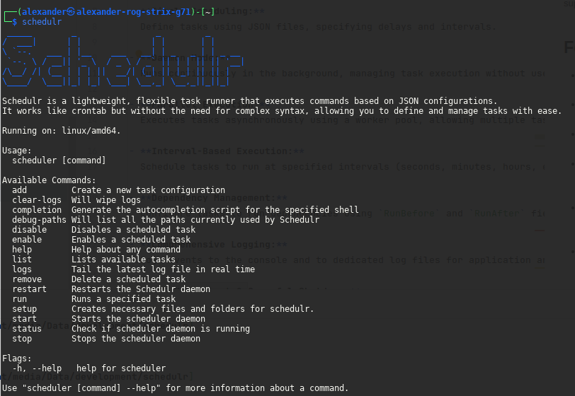

# Schedulr - A Modern Task Scheduler

[](https://github.com/alexanderthegreat96/schedulr/actions/workflows/ci.yml)

Schedulr is a lightweight, crontab-inspired task scheduler that executes tasks based on JSON configurations. It supports shell commands and HTTP requests, running as a daemon with configurable execution intervals.



## Features

- **Simple Scheduling:**  
  Define tasks using JSON files, specifying delays and intervals.

- **Daemon Mode:**  
  Runs continuously in the background, managing task execution without user intervention.

- **Parallel Execution:**  
  Executes tasks asynchronously using a worker pool, allowing multiple tasks to run in parallel.

- **Interval-Based Execution:**  
  Schedule tasks to run at specified intervals (seconds, minutes, hours, etc.) based on your JSON configuration.

- **Dependency Management:**  
  Name another task in a task's `run_before` or `run_after` field and it runs
  immediately before or after, so prerequisites execute in order.

- **Comprehensive Logging:**  
  Logs events to the console and to dedicated log files for application and task events. Real-time log tailing and periodic log wiping features are also provided.

- **PID Management & Graceful Shutdown:**  
  Uses a PID file to prevent multiple instances and supports clean shutdown when receiving termination signals.

## Getting Started

### Prerequisites

- [Go](https://golang.org/dl/) 1.23 or later (only to build it; the released
  binaries need no Go installed)
- Mac OS / Linux / Windows

### Usage

1. **Download Schedulr**

   Head over to the [Releases](https://github.com/alexanderthegreat96/schedulr/releases) page and download the latest binary for your system architecture.

2. **Install the Binary**

   Move the downloaded `schedulr` binary to a directory of your choice and make it executable:

   ```bash
   chmod +x schedulr
   ```

3. **Run the CLI Helper**

   Launch the built-in help menu to initialize necessary files and view available commands:

   ```bash
   ./schedulr --help
   ```

4. **Create Your First Task**

   Use the `add` command to define a new task. For example:

   ```bash
   ./schedulr add shell "my-task"
   ```

   You can also use `http` as the task type to send HTTP requests.

5. **Manage Your Tasks**

   All created task files will be stored in the `tasks/` directory, organized by type (e.g., `tasks/shell/`, `tasks/http/`).

6. **Start the Scheduler Daemon**

   Start Schedulr in daemon mode to begin automatic execution of your tasks:

   ```bash
   ./schedulr start
   ```

7. **That’s It! 🎉**

   Your tasks will now run automatically based on their configured intervals. Use `schedulr logs` to monitor output in real-time.

---

✅ Need more examples? Run:

```bash
./schedulr help
```

8. **Setup as auto-start in Linux / Macos**

In order to auto-start this and use the `schedulr-daemon`, it's recomanded that you use whatever auto-start service you might have
and run the following command: `cd /home/your-user/schedulr && ./schedulr start`.

A PID file left behind by a reboot or a crash no longer needs clearing by hand:
`start` checks whether the recorded process is actually alive and removes the
file itself if it isn't.

> Run it from schedulr's own directory, as above. `schedulr.config` is located
> relative to the working directory, so starting it from somewhere else makes
> every setting fall back to its default. The provided `auto-start.sh` /
> `auto-start.ps1` scripts and the systemd / launchd units below already do
> this for you.

Example on linux: 

```bash
cd ~/.config/autostart/
vim schedulr.desktop
```

```bash
[Desktop Entry]
Type=Application
Name=Schedulr Daemon
Exec=sh -c "cd /home/your-user/schedulr && ./schedulr start"
Hidden=true
NoDisplay=true
X-GNOME-Autostart-enabled=true

```

### Developing

1. **Clone the repository:**

   ```bash
   git clone https://github.com/yourusername/schedulr.git
   cd schedulr
   ```

2. **Running Tests**

   Schedulr includes a comprehensive test suite for both the core scheduler and command-line interface. Use the provided Makefile to run tests:

   ```bash
   # Run all tests
   make test

   # Run tests with verbose output
   make test-verbose

   # Run tests with coverage report (generates coverage.html)
   make test-coverage

   # Run only core package tests
   make test-core

   # Run only cmd package tests
   make test-cmd

   # Clean test cache and artifacts
   make clean
   ```

   Tests are organized by package and can also be run directly using Go:

   ```bash
   # Run a specific test
   go test ./core -run TestCreateTask -v

   # Run tests with race condition detection
   go test -race ./...
   ```

## Usage

### Running the Scheduler

To start Schedulr as a daemon, simply run:

```bash
./schedulr
```

This starts the scheduler loop, which continuously loads tasks from JSON files, schedules them based on their delay and interval configurations, and dispatches them for asynchronous execution.

### Adding Tasks

Use the `add` command to create a new task configuration. Supported task types are:

- `shell`: Executes a shell command.
- `http`: Executes an HTTP request.

Examples:

```bash
./schedulr add shell "Backup Database"
./schedulr add http "Ping API"
```

Task configurations are stored as JSON files in the designated tasks directory.

The repository ships a set of examples under `tasks/` covering each feature — an
interval task, clock-time scheduling with and without a day filter, args mode, a
dependency pair, and both HTTP methods. They are all disabled, so a fresh clone
runs nothing; enable one with `schedulr enable shell echo-hello` to try it, or
copy one as a starting point.

### Viewing and Managing Logs

Schedulr logs output to both the console and log files. A background log wiper function can be configured to truncate log files every x seconds to prevent indefinite growth.

#### Tailing Logs

Schedulr includes a built-in command to tail the latest log file in real time. For example, to tail the application logs:

```bash
./schedulr logs app
```

Or for task logs:

```bash
./schedulr logs task backup-database
./schedulr logs task ping-api
```

The command finds the most recently modified log file in the appropriate directory and outputs new entries using the application's logging format.

## Command Line Usage

Schedulr provides a command-line interface powered by [Cobra](https://github.com/spf13/cobra)

### 🔤 Command Name Normalization

All command-line arguments are automatically normalized to ensure consistent task matching:

- Any command or task name provided is converted to **PascalCase**, then to **kebab-case**.  
  **Example:**  
  `"Backup Database"` → `"BackupDatabase"` → `"backup-database"`

- When referencing an existing task by name (e.g., from the filesystem or scheduler), the reverse process is applied:  
  **Example:**  
  `"backup-database"` → `"BackupDatabase"`

This ensures that task names are matched reliably regardless of formatting or casing in user input.

### `add`

- **Usage:** `schedulr add [task_type] [task_name]`
- **Description:** Creates a new scheduled task configuration in JSON format.
- **Supported Task Types:**
  - `shell`: Executes a shell command.
  - `http`: Executes an HTTP request.

Examples:

```bash
schedulr add shell backup-database
schedulr add http ping-api
```

### `logs`

- **Usage:** `schedulr logs [log_type] [task_name]`
- **Description:** Tails the most recently modified log file in real time.
- **Supported Log Types:**
  - `app`: Application logs.
  - `task`: Task logs.

If no log type is specified, it defaults to `app`.

Examples:

```bash
schedulr logs app
schedulr logs task backup-database
```

### `task-path`

- **Usage:** `schedulr task-path [task_type] [task_name]`
- **Description:** Prints the absolute path of the JSON file backing a task, and nothing else, so it can be handed straight to an editor or any other tool.

The banner is suppressed for this command, so stdout holds only the path. If the
task does not exist the message goes to stderr and the exit status is non-zero,
which makes it fail loudly inside command substitution instead of expanding to
something useless.

Examples:

```bash
schedulr task-path shell backup-database
# /opt/schedulr/tasks/shell/BackupDatabase.json

vim $(schedulr task-path shell backup-database)
code $(schedulr task-path http ping-api)
```

### Default Behavior

Running `schedulr` without any arguments starts the scheduler daemon, which continuously processes and schedules tasks.

### Help Command

Use `schedulr help` or `schedulr --help` to view detailed information about all commands and options.

## Task Execution Details

### Scheduling

Every task lives in a plain JSON file that Schedulr watches. **Edit it at any time — every field is hot‑reloaded, no service restart required.**

```jsonc
{
  "name": "MyTask",            // unique, human‑friendly label
  "execution": {
    "interval": {               // run *again* after this span
      "years":   0,
      "months":  0,
      "weeks":   0,
      "days":    0,
      "hours":   0,
      "minutes": 0,
      "seconds": 0
    },
    "delay": {                  // optional pause *before* first run
      "years":   0,
      "months":  0,
      "weeks":   0,
      "days":    0,
      "hours":   0,
      "minutes": 0,
      "seconds": 0
    },
    "last_ran_at": "",         // auto‑filled timestamp (RFC 3339)
    "run_before": "",          // name of a task to run BEFORE this one, e.g. AnotherTask
    "run_after":  "",          // name of a task to run AFTER this one
    "is_enabled": false,       // flip to true to activate
    "dependency_only": false,  // true = runs only when another task names it
    "at":           [],        // clock times, e.g. ["03:00"] - overrides interval/delay
    "days":         [],        // optional filter, e.g. ["mon","fri"]
    "day_of_month": []         // optional filter, e.g. [1, 15]
  },
  "command":    "",            // shell line to execute, or a program path when args is set
  "args":       [],            // optional: discrete arguments, run with no shell at all
  "shell_type": ""             // linux / macos use the default execution agent. For windows use: cmd / powershell
}
```

### How Schedulr interprets the fields

| Field                        | Meaning                                                                                      |
| ---------------------------- | -------------------------------------------------------------------------------------------- |
| **delay**                    | Wait this long *after enabling* before the very first run.                                   |
| **interval**                 | How long to wait *after each run* before scheduling the next one. All zeros → one‑shot task. |
| **last\_ran\_at**            | Updated by Schedulr; normally leave it alone.                                                |
| **run\_before**              | Name of another task to run *before* this one. Empty means none. Not a time.                 |
| **run\_after**               | Name of another task to run *after* this one. Empty means none. Not a time.                  |
| **is\_enabled**              | Master on/off switch. `false` pauses without resetting counters.                             |
| **dependency\_only**         | `true` gives the task no schedule of its own; it runs only when another task names it.       |
| **at**                       | Clock times to run at, `HH:MM` or `HH:MM:SS`. Setting this overrides **interval** and **delay**. |
| **days**                     | Optional day-of-week filter, e.g. `["mon","fri"]`. Only meaningful alongside **at**.         |
| **day\_of\_month**           | Optional day-of-month filter, e.g. `[1, 15]`. Only meaningful alongside **at**.              |
| **command**                  | The shell line to run, or the path of a program when **args** is set.                        |
| **args**                     | Optional. When non-empty the command is executed directly with these arguments and no shell. |

All numeric sub‑fields accept any non‑negative integer, so you can express everything from **“every 90 seconds”** (`seconds = 90`) to **“once a quarter”** (`months = 3`).

### Interval or clock times

There are two ways to say when a task runs, and they answer different questions.

**`interval` — a duration since the last run.** Good for "every so often", where
the exact moment does not matter:

```json
"execution": { "interval": { "minutes": 5 } }
```

**`at` — times on the clock.** Good for anything that has to happen *at* a time:

```json
"execution": { "at": ["03:00"] }
"execution": { "at": ["09:00", "13:00", "17:00"] }
"execution": { "at": ["09:00"], "days": ["mon", "tue", "wed", "thu", "fri"] }
"execution": { "at": ["06:00"], "day_of_month": [1, 15] }
```

Setting `at` puts the task in calendar mode: `interval` and `delay` are then
ignored, and a line is logged saying so if they were set.

Details worth knowing:

- **`days` and `day_of_month` both have to match when both are set.** `days: ["thu"]`
  with `day_of_month: [1]` means "the 1st, when it falls on a Thursday", which may
  be months away. Note that cron does the opposite and fires when *either* matches;
  this is deliberately the other way round, because for an explicit list AND is the
  reading people expect.
- **A missed time is simply missed.** If the daemon was down at 03:00 the task next
  runs at the following 03:00; there is no catch-up. That matches cron rather than
  anacron.
- **An impossible schedule is reported, not silently ignored.** Anything that cannot
  fire within a year, an unparsable time, an unknown day name, or a `day_of_month`
  outside 1-31 keeps the task out of the schedule and logs why, rather than parking
  a task that quietly never runs.
- **Times are machine-local.** On a spring-forward day a time that does not exist
  runs at the next valid instant.
- **`interval` tasks no longer drift.** The next run is computed from the time a run
  was *scheduled* for rather than from when it actually started, so lateness does
  not accumulate over a long series.

### Choosing a shell

| Platform      | Default | Accepted values for `shell_type`                |
| ------------- |---------| ----------------------------------------------- |
| Windows       | `cmd`   | `cmd` (default)  •  `powershell`                |
| Linux / macOS | `bash`  | Any executable on `$PATH` (e.g., `bash`, `zsh`) |

*Leave **`shell_type`** empty to use the default above.* Specify `"powershell"` on Windows for cmdlet goodness, or `"cmd"` for classic batch syntax.

#### `command` vs `args`

A shell task can be written in either of two modes.

**Shell mode** — `command` only, `args` empty. The whole string is handed to a
shell (`cmd /C`, `powershell -Command`, `sh -c`), so pipes, redirection,
chaining and variable expansion all work:

```json
{ "command": "pg_dump mydb | gzip > backup.gz", "args": [] }
```

**Args mode** — set `args`. `command` is then the path of a program and each
entry in `args` is passed to it verbatim, with no shell anywhere:

```json
{
  "command": "C:\\Program Files\\Python\\python.exe",
  "args": ["C:\\My Scripts\\report.py", "--out", "C:\\Out Dir\\r.csv"]
}
```

Use args mode when you want:

- **No quoting or escaping.** Each argument is its own JSON string, so spaces,
  quotes and `& | > ^ ;` are passed through untouched instead of needing to be
  escaped for both JSON and the shell.
- **The same behaviour on every platform.** A shell-mode string is interpreted
  differently per OS: `a && b` works under `cmd` and `sh` but is a parse error
  in Windows PowerShell 5.1, and `%VAR%` / `$VAR` differ. Args mode has no
  shell, so it behaves identically everywhere.
- **No surprise expansion.** `%USERNAME%`, `$HOME` and `*.go` reach the program
  literally rather than being expanded or glob-matched.

> **On Windows, quoting in shell mode works but is yours to get right.** A
> quoted path such as `"C:\Program Files\app.exe" --flag "a b"` runs correctly,
> and so do pipes, `&&` and redirection. But every argument containing a space
> needs its own pair of quotes, and an unquoted `&` or `|` is a `cmd` operator
> rather than part of your argument. Args mode sidesteps all of that, which is
> why it is the better choice for a program path with spaces.

`shell_type` is ignored in args mode, since no shell is involved. If `args` is
set, `command` must name a single executable — leaving a full shell line there
is reported as an error rather than being run.

#### `is_gui`

On Windows, `is_gui` controls whether the task gets a window:

- `false` (the default) runs the task with no window at all. A task on a short
  interval would otherwise flash a console window on screen on every run.
- `true` lets the task show its window, for when the command is meant to put
  something on screen.

On Linux this field is ignored. On macOS, `is_gui: true` launches the command
through `open -a`, treating it as an application name rather than a shell
command.


### Dependencies

`run_before` and `run_after` hold the **name of another task**, not a time. When
the task runs, the task named in `run_before` runs first, then the task itself,
then the task named in `run_after`:

```json
{
  "name": "GenerateReport",
  "execution": {
    "interval": { "hours": 24 },
    "run_before": "FetchData",
    "run_after": "UploadReport",
    "is_enabled": true
  },
  "command": "python report.py"
}
```

That gives `FetchData` → `GenerateReport` → `UploadReport`, all on one worker,
one after another.

Details worth knowing:

- **Names, resolved across both task types.** A shell task can name an HTTP task
  and the other way round. The name is matched against each task's `name` field.
- **Chains work.** A dependency's own `run_before` / `run_after` are resolved
  too, so `A → B → C` runs end to end.
- **Each task runs at most once per chain.** A circular configuration (`A` names
  `B`, `B` names `A`, or a task naming itself) is logged and cut off rather than
  recursing until the stack gives out.
- **A disabled dependency is skipped, and the task that named it still runs.**
- **A dependency that is not due yet is waited for, but only briefly.** The wait
  is capped by `DEPENDENCY_MAX_WAIT_SECONDS` (default 60); beyond that the
  dependency is skipped for that run and the task still goes ahead. The wait
  happens on a worker, so an unbounded one would starve the pool.
- **A name that matches no task is simply ignored**, rather than failing the task.
- **A dependency keeps its own schedule unless you say otherwise.** A task named
  as a dependency is an ordinary scheduled task by default: enabled with its own
  `interval`, it runs on that interval *as well as* being pulled in by whatever
  depends on it. Set `dependency_only: true` to give it no schedule of its own,
  so it runs only when something names it. `is_enabled` still has the final say —
  a disabled task is skipped either way.
- **A dependency already running is skipped, not waited for.** If the same task
  is in flight — its own interval fired, or two chains name it at once — the
  chain logs a warning and carries on rather than running a second copy. Marking
  it `dependency_only` removes that collision for the usual case. It is a skip
  rather than a wait on purpose: a task counts as in flight while it is queued,
  so waiting could leave every worker blocked on something no worker is free to
  run.
- **`schedulr run` ignores dependencies.** Dependencies are resolved by the
  daemon only. A manual `schedulr run shell make-report` executes just that one
  task, so it is not a way to test a chain — start the daemon for that.

### HTTP Task Execution

HTTP tasks support configurable methods, headers, and optional JSON bodies. Schedulr creates and sends HTTP requests, logs response status and body, and handles errors accordingly.

## Configuration

- **Task Directory:**  
  Task configurations are stored as JSON files under a specified directory, as defined in your configuration file.

- **Log File Paths:**  
  Set paths for your application and task log files using the `AppLogFilePath` and `TasksLogFilePath` environment variables.

- **Interval Settings:**  
  Control task execution timing via JSON fields for delay and interval (using units like seconds, minutes, and hours).

### `schedulr.config`

`schedulr.config` is read from the directory holding the `schedulr` binary, and
from the working directory when there is no config beside the binary (the `go run`
case). Any key left out falls back to its default.

> **Start schedulr from its own directory.** The config file is located relative
> to the working directory, so launching it from elsewhere makes every setting
> fall back to its default — silently. The daemon logs the settings it actually
> resolved on startup, so `schedulr logs app` will tell you whether your config
> was picked up. The bundled auto-start scripts and the systemd / launchd units
> in this README all set the working directory for you.
>
> The committed `.project-root` file is part of this: it marks the directory as
> schedulr's root so the config beside the binary is found. It is recreated
> automatically if deleted, and is safe to commit.

| Key                           | Default      | Description                                                                                                                                                              |
|-------------------------------|--------------|--------------------------------------------------------------------------------------------------------------------------------------------------------------------------|
| `SCHEDULR_DEV`                | `false`      | Developer mode. Resolves paths against the working directory instead of the binary's directory.                                                                          |
| `LOG_DATA`                    | `true`       | Write logs to files.                                                                                                                                                     |
| `LOG_WIPE_INTERVAL_SECONDS`   | `100`        | How often old log files are cleared. Log files the daemon still has open are never wiped. `0` disables wiping.                                                            |
| `WORKER_COUNT`                | `4`          | Number of tasks that may execute in parallel.                                                                                                                            |
| `RELOAD_INTERVAL_SECONDS`     | `30`         | How often the daemon re-reads the task files. This is what makes `add`, `enable`, `disable` and `remove` take effect without restarting the daemon.                       |
| `DEPENDENCY_MAX_WAIT_SECONDS` | `60`         | Longest a worker will wait for a `run_before` / `run_after` dependency to come due. A dependency further out is skipped for that run; the task that declared it still runs. |
| `HTTP_LOG_BODY_LIMIT`         | `2048`       | Largest HTTP response body, in bytes, written to a task log. Set to `0` to keep response bodies out of the logs entirely.                                                 |
| `ENABLE_SCHEDULR_SERVICE`     | `true`       | Honour systemd / launchd management when present.                                                                                                                        |
| `SYSTEMD_COMMAND`             | `systemctl`  | Command used to query and stop the Linux service.                                                                                                                        |
| `LAUNCHD_COMMAND`             | `launchctl`  | Command used to query and stop the macOS service.                                                                                                                        |
| `SERVICE_NAME`                | `schedulr`   | Service name used with systemd / launchd.                                                                                                                                |

The daemon logs the settings it actually resolved on startup, so `schedulr logs app`
will show whether a config change was picked up.


## Available Commands

| Command      | Description                                                |
|--------------|------------------------------------------------------------|
| `add`        | Create a new task configuration                            |
| `remove`     | Deletes a task configuration                               |
| `clear-logs` | Wipe log files                                             |
| `completion` | Generate the autocompletion script for the specified shell |
| `help`       | Help about any command                                     |
| `list`       | Lists available tasks                                      |
| `logs`       | Check logs for both tasks and app logs                     |
| `run`        | Runs a specified task                                      |
| `setup`      | Creates necessary files and folders for Schedulr           |
| `start`      | Starts the scheduler daemon                                |
| `status`     | Check if scheduler daemon is running                       |
| `stop`       | Stops the scheduler daemon                                 |
| `enable`     | Enables a task                                             |
| `disable`    | Disables a task                                            |
| `task-path`  | Prints the full path to a task's JSON config file          |

# Setting up Schedulr as a Service

## ✅ Linux (systemd)

### Using the Auto-Start Script

Schedulr includes a built-in `auto-start.sh` script that simplifies daemon startup on Linux. This script:

- Cleans up any stale PID file from previous crashes
- Starts the Schedulr daemon
- Logs all output to `schedulr_autostart.log` for debugging
- Verifies the daemon started successfully

**Usage:**

```bash
chmod +x auto-start.sh
./auto-start.sh
```

You can integrate this into your systemd service or cron job for automatic startup:

```bash
# Make it executable
chmod +x /path/to/schedulr/auto-start.sh

# Test it directly
/path/to/schedulr/auto-start.sh

# Check the log
tail -f /path/to/schedulr/schedulr_autostart.log
```

### Create the service entry
```bash 
vim /etc/systemd/system/schedulr.service
```

### Service File Contents

**Option 1: Direct binary execution**
```ini
[Unit]
Description=Schedulr background service
After=network.target

[Service]
Type=simple
ExecStart=/home/your-username/schedulr/schedulr start
WorkingDirectory=/home/your-username/schedulr
Restart=on-failure
RestartSec=5
User=your-username

[Install]
WantedBy=default.target
```

**Option 2: Using the auto-start.sh script (recommended)**

The auto-start.sh script handles PID cleanup and logging automatically:

```ini
[Unit]
Description=Schedulr background service
After=network.target

[Service]
Type=simple
ExecStart=/home/your-username/schedulr/auto-start.sh
WorkingDirectory=/home/your-username/schedulr
Restart=on-failure
RestartSec=5
User=your-username

[Install]
WantedBy=default.target
```

### Enable and Start the Service
```bash
sudo systemctl daemon-reload
sudo systemctl enable schedulr
sudo systemctl start schedulr
sudo systemctl status schedulr
```

---

## ✅ macOS (launchd)

### Create the launchd service file

**For user services:**
```bash
vim ~/Library/LaunchAgents/com.yourusername.schedulr.plist
```

**For system-wide services:**
```bash
sudo vim /Library/LaunchDaemons/com.yourusername.schedulr.plist
```

### Service File Contents (User version)
```xml
<?xml version="1.0" encoding="UTF-8"?>
<!DOCTYPE plist PUBLIC "-//Apple//DTD PLIST 1.0//EN" 
  "http://www.apple.com/DTDs/PropertyList-1.0.dtd">
<plist version="1.0">
<dict>
    <key>Label</key>
    <string>com.yourusername.schedulr</string>

    <key>ProgramArguments</key>
    <array>
        <string>/Users/your-username/schedulr/schedulr</string>
        <string>start</string>
    </array>

    <key>WorkingDirectory</key>
    <string>/Users/your-username/schedulr</string>

    <key>RunAtLoad</key>
    <true/>

    <key>KeepAlive</key>
    <true/>

    <key>StandardOutPath</key>
    <string>/tmp/schedulr.log</string>

    <key>StandardErrorPath</key>
    <string>/tmp/schedulr.err</string>
</dict>
</plist>
```

### Load and Start the Service
```bash
launchctl load ~/Library/LaunchAgents/com.yourusername.schedulr.plist
launchctl start com.yourusername.schedulr
launchctl bootstrap gui/$(id -u) ~/Library/LaunchAgents/com.yourusername.schedulr.plist
```

### Stop or Unload the Service
```bash
launchctl stop com.yourusername.schedulr
launchctl unload ~/Library/LaunchAgents/com.yourusername.schedulr.plist
```
## Licence
### MIT License

#### Copyright (c) [2025] [alexanderthegreat96]

Permission is hereby granted, free of charge, to any person obtaining a copy
of this software and associated documentation files (the “Software”), to deal
in the Software without restriction, including without limitation the rights  
to use, copy, modify, merge, publish, distribute, sublicense, and/or sell  
copies of the Software, and to permit persons to whom the Software is  
furnished to do so, subject to the following conditions:

The above copyright notice and this permission notice shall be included in  
all copies or substantial portions of the Software.

THE SOFTWARE IS PROVIDED “AS IS”, WITHOUT WARRANTY OF ANY KIND, EXPRESS OR  
IMPLIED, INCLUDING BUT NOT LIMITED TO THE WARRANTIES OF MERCHANTABILITY,  
FITNESS FOR A PARTICULAR PURPOSE AND NONINFRINGEMENT. IN NO EVENT SHALL THE  
AUTHORS OR COPYRIGHT HOLDERS BE LIABLE FOR ANY CLAIM, DAMAGES OR OTHER  
LIABILITY, WHETHER IN AN ACTION OF CONTRACT, TORT OR OTHERWISE, ARISING FROM,  
OUT OF OR IN CONNECTION WITH THE SOFTWARE OR THE USE OR OTHER DEALINGS IN  
THE SOFTWARE.
